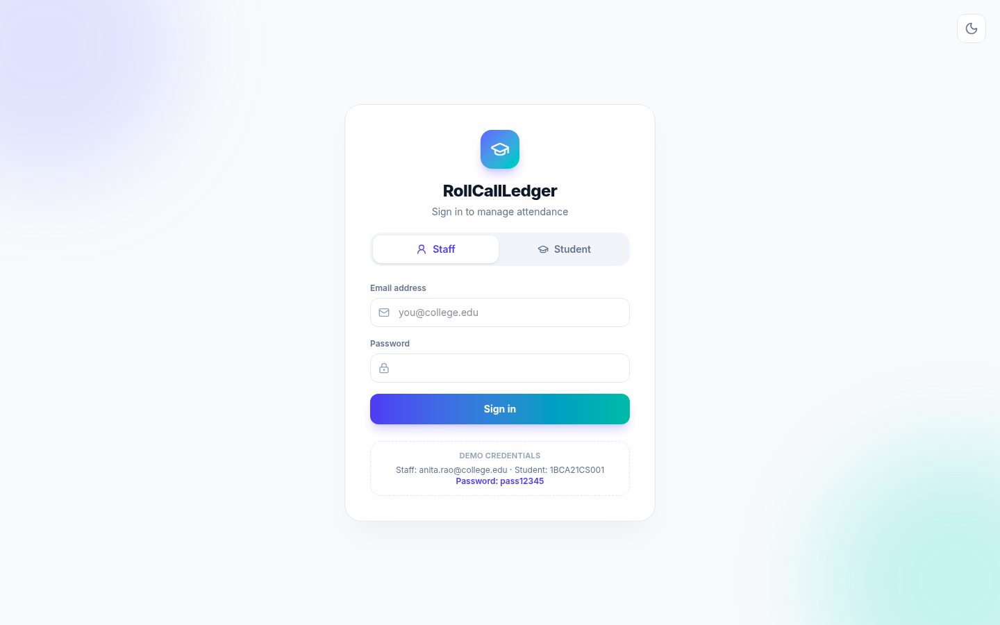
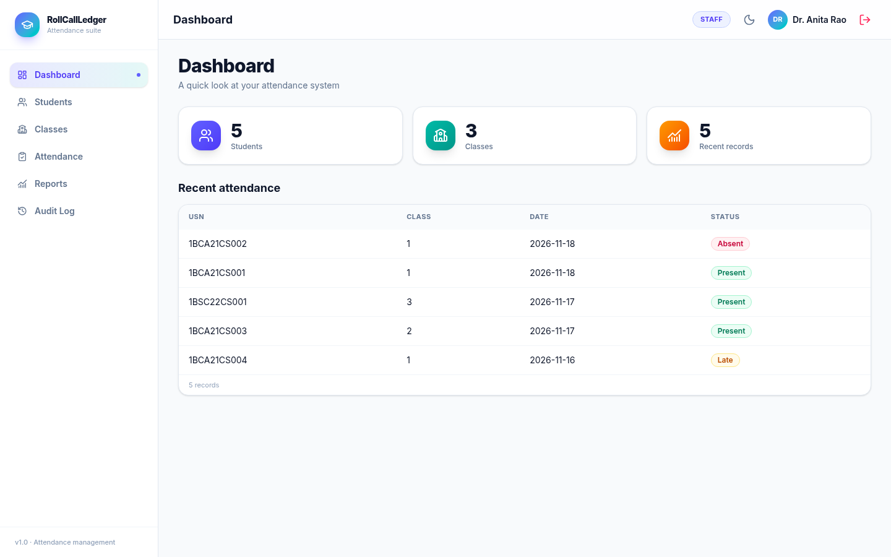
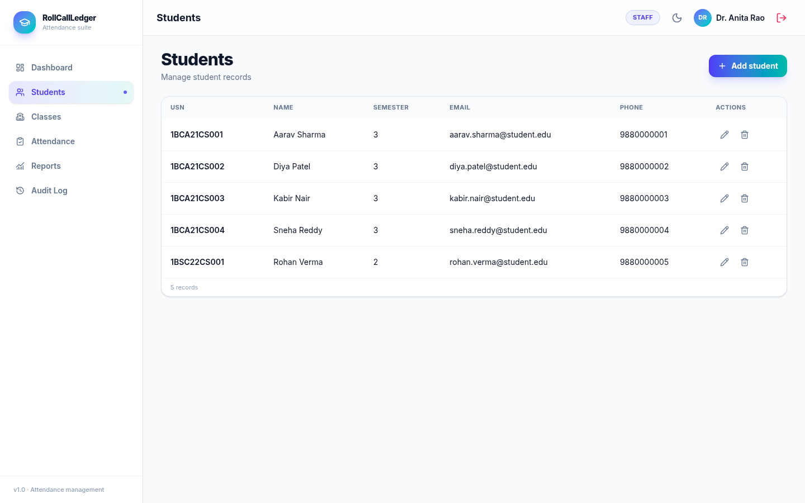
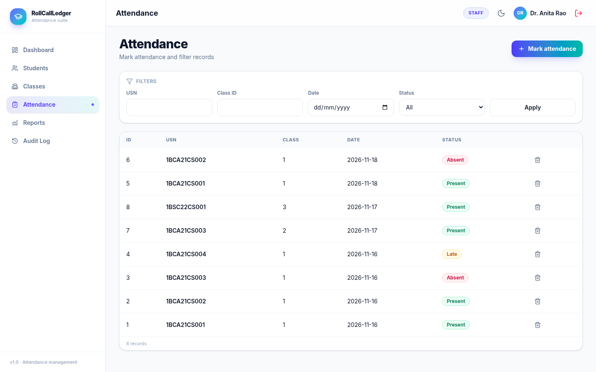
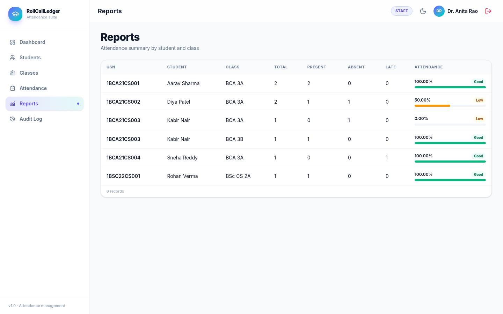
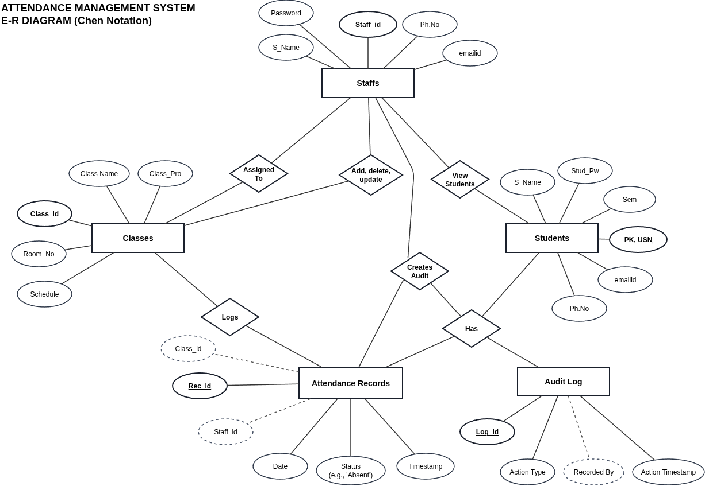
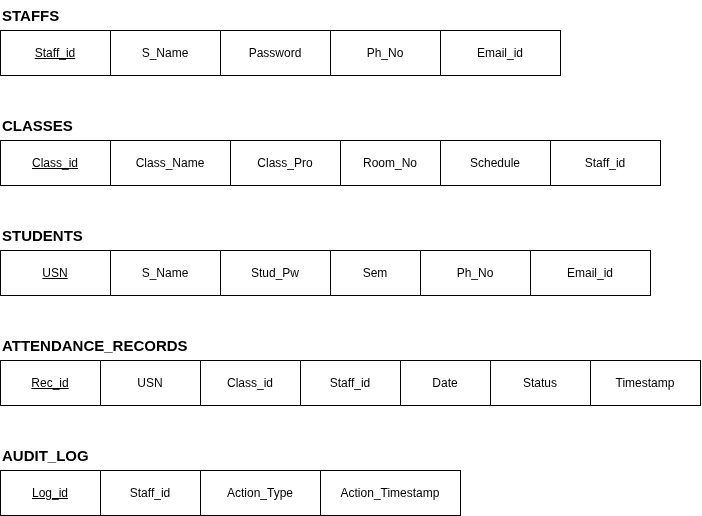

# RollCallLedger

A college DBMS mini-project: a student–teacher attendance tracker with a Rust REST API, PostgreSQL database, and a React dashboard.

## Preview (light mode)

| Login | Dashboard |
| --- | --- |
|  |  |

| Students | Attendance |
| --- | --- |
|  |  |

| Reports |
| --- |
|  |

## What it does

- Staff log in with email, students log in with USN or email.
- Staff can manage students and classes, mark attendance, filter records, and view reports.
- Students see only their own attendance and per-class summary.
- Every attendance insert/update/delete is written to an audit log by a database trigger; staff CRUD actions and logins are also audited.
- Passwords are stored as Argon2id hashes; API access uses signed JWTs (24h expiry).
- The UI supports light and dark mode and is built with Tailwind CSS and Framer Motion animations.

## Tech stack

| Layer | Technology |
| --- | --- |
| Database | PostgreSQL 13+ (`sqlx`, migrations in `database/`) |
| Backend | Rust, Axum, Tokio, sqlx, JWT (`jsonwebtoken`), Argon2, tower-http |
| Frontend | React 19, Vite 8, TypeScript 7, Tailwind CSS 4, Framer Motion, Lucide icons |

## Repository layout

```
database/
  dbmsminiprojectERdiagram.drawio.png   ER diagram (source embedded in PNG)
  dbmsminiprojectSchemadiagram.drawio.png Relational schema diagram
  schema_postgres.sql                   Primary PostgreSQL schema + demo data
  schema.sql                            MySQL equivalent (reference only)
backend/
  src/main.rs                           Server bootstrap, config, CORS, tracing
  src/auth.rs                           JWT claims + role-based extractors
  src/state.rs, src/db.rs               Shared state and connection pool
  src/error.rs                          API error type and HTTP mapping
  src/models/                           Request/response and row structs
  src/routes/                           Auth, staff, students, classes, attendance, reports, audit, student
  src/utils/                            Password hashing and audit helper
  src/bin/hash_password.rs              CLI helper to hash passwords
  .env.example                          Environment template (never commit real .env)
frontend/
  src/api/                              Typed API client and data types
  src/context/                          Auth, theme, and feedback (snackbar/confirm) providers
  src/components/                       Layout, login, tables, forms, loading, error boundary
  src/pages/                            Dashboard, Students, Classes, Attendance, Reports, Audit, My Attendance
scripts/start.sh                        Starts backend and frontend together
docs/screenshots/                       Light-mode UI screenshots used in this README
```

## Database diagrams

The original diagrams are stored in `database/` (the PNG files also contain their editable diagrams.net source).

**E-R diagram**



**Relational schema**



## Prerequisites

- Rust (edition 2024 toolchain)
- Node.js 20+ and npm
- PostgreSQL running on `127.0.0.1:5432`

## Setup

### 1. Database

The PostgreSQL server must be reachable. Create and seed the database:

```bash
psql -h 127.0.0.1 -U postgres -c "CREATE DATABASE rollcallledger WITH ENCODING 'UTF8'"
psql -h 127.0.0.1 -U postgres -d rollcallledger -f database/schema_postgres.sql
```

This creates `staffs`, `classes`, `students`, `attendance_records`, and `audit_log`, plus the two reporting views and three audit triggers. It also loads demo data: 3 staff, 3 classes, 5 students, and sample attendance.

### 2. Backend

```bash
cd backend
cp .env.example .env
# edit .env: set a strong random JWT_SECRET
cargo run
```

Environment variables:

| Variable | Default | Purpose |
| --- | --- | --- |
| `DATABASE_URL` | `postgres://postgres@127.0.0.1:5432/rollcallledger` | PostgreSQL connection |
| `JWT_SECRET` | required | Secret used to sign tokens |
| `PORT` | `3000` | API port |
| `CORS_ORIGIN` | `http://localhost:5173,http://127.0.0.1:5173` | Comma-separated allowed origins |

To hash a password for manual seeding: `cargo run --bin hash_password -- mypassword`.

### 3. Frontend

```bash
cd frontend
npm install
npm run dev
```

Open <http://127.0.0.1:5173>. If the backend is not at `http://localhost:3000`, set `VITE_API_URL` before starting Vite.

### 4. One-command start

From the repository root:

```bash
./scripts/start.sh
```

It checks PostgreSQL, builds the backend, and starts both servers. Press Ctrl+C to stop both.

## Demo credentials

| Role | Identifier | Password |
| --- | --- | --- |
| Staff | `anita.rao@college.edu` | `pass12345` |
| Student | `1BCA21CS001` | `pass12345` |

All seeded accounts use the same demo password. Hashes in `schema_postgres.sql` were generated with `backend/src/bin/hash_password.rs`.

## API overview

Base URL: `http://127.0.0.1:3000`

| Method | Path | Access | Description |
| --- | --- | --- | --- |
| GET | `/api/health` | public | Health check |
| POST | `/api/auth/staff/login` | public | Staff login |
| POST | `/api/auth/student/login` | public | Student login |
| GET | `/api/staff/me` | staff | Current staff profile |
| GET/POST | `/api/students` | staff | List / create students |
| PUT/DELETE | `/api/students/{usn}` | staff | Update / delete student |
| GET/POST | `/api/classes` | staff | List / create classes |
| PUT/DELETE | `/api/classes/{id}` | staff | Update / delete class |
| GET/POST | `/api/attendance` | staff | List (filterable) / upsert attendance |
| PUT/DELETE | `/api/attendance/{id}` | staff | Update status / delete record |
| GET | `/api/reports/attendance` | staff | Per-student attendance summary |
| GET | `/api/audit` | staff | Recent audit entries |
| GET | `/api/me/attendance` | student | Own attendance records |
| GET | `/api/me/summary` | student | Own per-class summary |

Authenticated routes expect `Authorization: Bearer <token>`.

## Verification

```bash
cd backend && cargo clippy --all-targets -- -D warnings
cd frontend && npm run build && npm run lint
```

The UI was also smoke-tested in a headless Chromium session: login, navigation, theme toggle, and data tables were verified against the running API.

## Production notes

- Replace the demo `JWT_SECRET` and disallow default credentials.
- Set `CORS_ORIGIN` to your real frontend origin(s); permissive CORS is not used.
- Passwords are hashed with Argon2id; never store plain text passwords.
- The frontend is code-split by page and served from `dist/` after `npm run build`.
- This is a demo/academic project and has not been hardened for internet-facing deployment.

## Disclaimer

This repository was largely **AI vibe coded** — generated and refined with an AI assistant. It is provided as-is for learning and presentation purposes. No warranty is provided; audit it yourself before relying on it for anything important.
